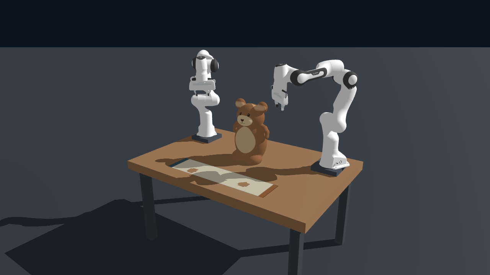
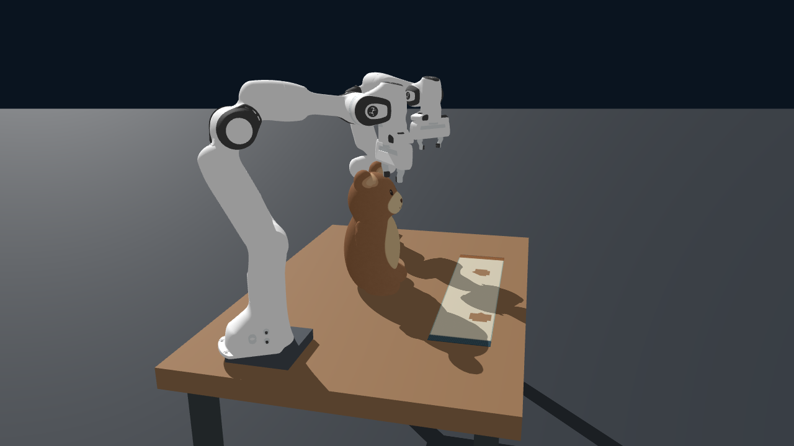
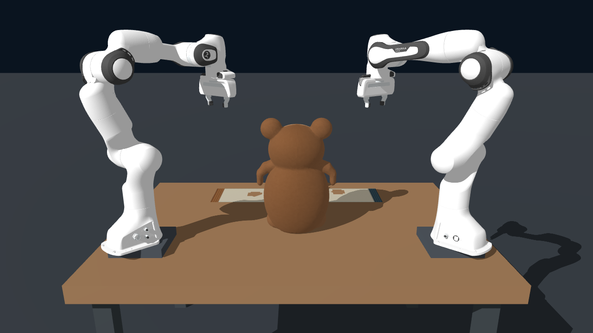

# 四张原始输入图片

这四张 PNG 是用户提供的同一仿真初始状态的不同视角。仓库采用简短文件名，图像内容与原文件逐字节一致，未作裁剪、缩放或重绘。

| 仓库文件 | 原始文件名 | SHA-256 |
|---|---|---|
| [view_1.png](view_1.png) | `Codex Image Oct 20, 2026, 03_18_59 PM.png` | `65ef35256a94fed3d4f0b1d9cb28d66f6b7f671ddc384ab0ddd079383e9209a6` |
| [view_2.png](view_2.png) | `Codex Image Oct 20, 2026, 03_19_14 PM.png` | `8d84d5b0029a175f774a510cfe58a61fd851a30d912ab946667c2203dadbcbed` |
| [view_3.png](view_3.png) | `Codex Image Oct 20, 2026, 03_22_04 PM.png` | `d601375209100980b6c51a00c1077a7eb4147dbfa9e303d57a3be4dc4d745b7f` |
| [view_4.png](view_4.png) | `Codex Image Oct 20, 2026, 05_09_38 PM.png` | `09b2112d8c8cc7b73622ac029d5af5b0146e9d0b49dbfbb40424a77952108f9d` |

## 图 1：斜前方

## 图 2：俯视

## 图 3：侧面

## 图 4：背面

